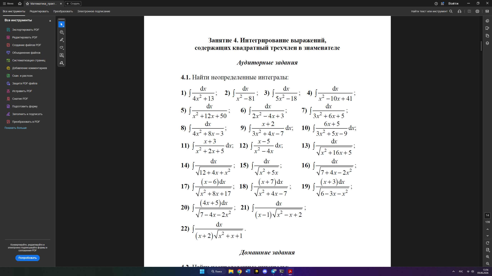

# Заголовок 1
## Заголовок 2
### Заголовок 3
#### Заголовок 4
##### Заголовок 5
###### Заголовок 6

Заголовок 1
=

Заголовок 2
-

* пункт списка
- пункт
+ пункт

1. пункт
    * пункт списка
    * пункт
    * пункт
2. пункт

***

Тут текст.  
Для переноса на **новую** ***строку*** используется два пробела.

```
a = 5;
b = 6;
```

>Цитата  
Новый текст

[Текст](http://google.com)



[](http://google.com)

Item      | Value  |
:-------- |:-----: |
Computer  |1       |
Phone     |2       |
Pipe      |3       |